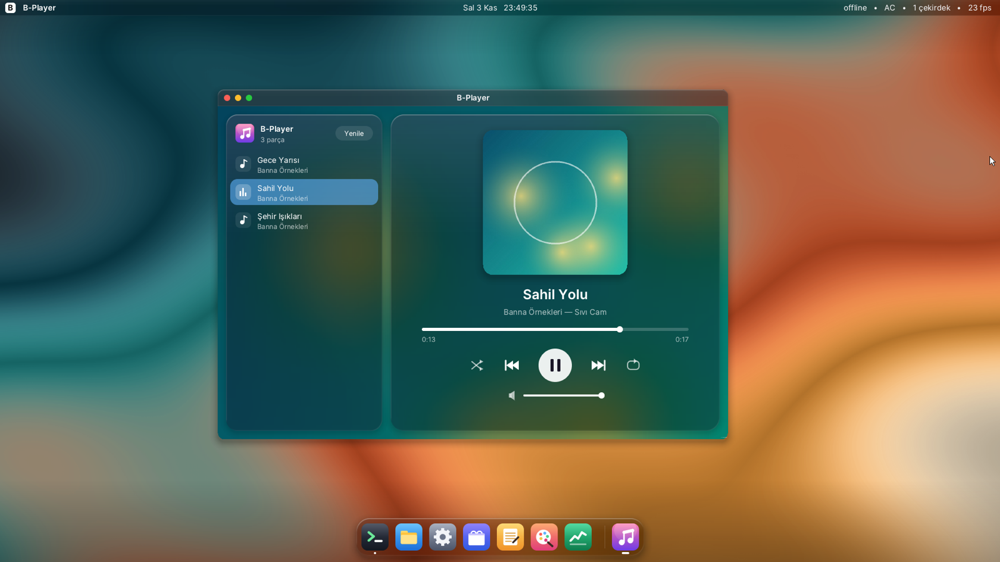
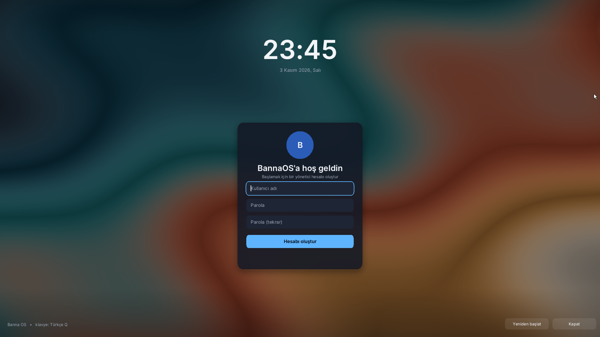
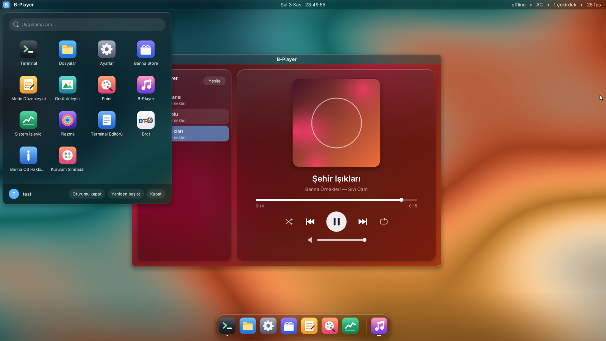
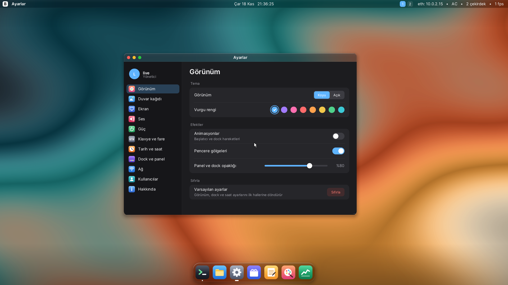
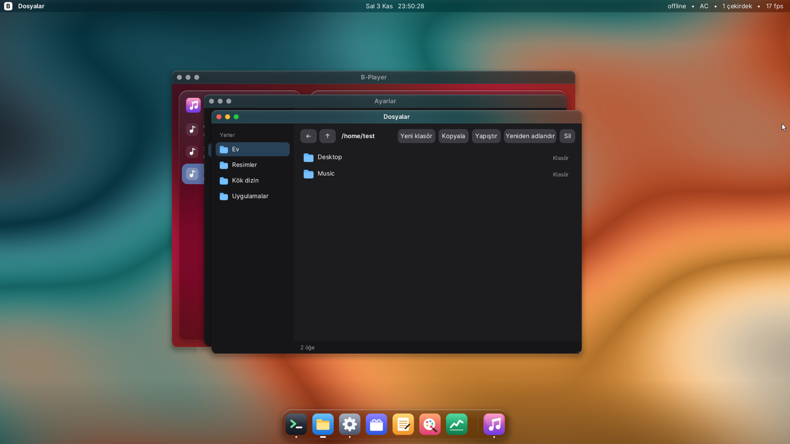
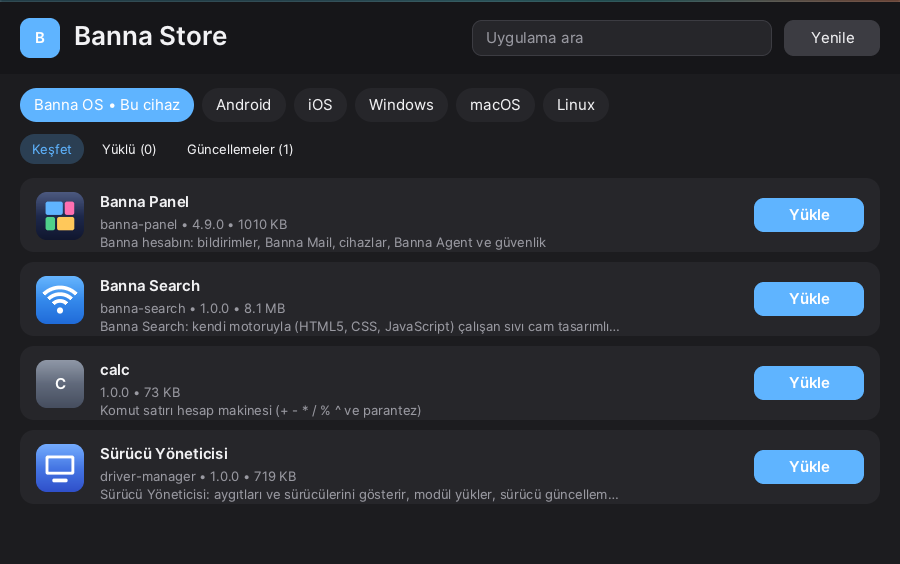
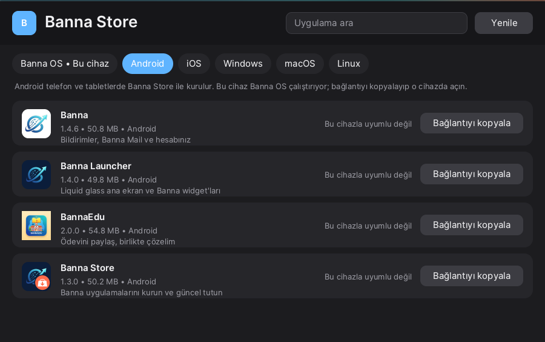
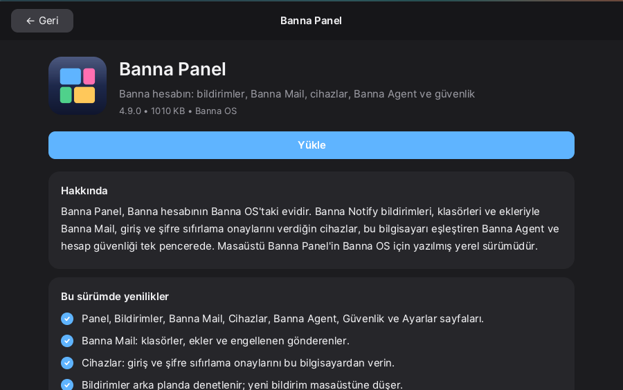
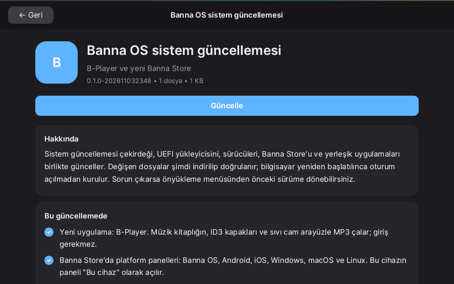

<div align="center">

# Banna OS

**Rust ile sıfırdan yazılmış, sıvı cam masaüstüne sahip x86_64 işletim sistemi.**

Çekirdek, sürücüler, dosya sistemleri, ağ yığını, TLS, web motoru, MP3 çözücü ve masaüstü
uygulamaları — hepsi bu depoda, dış crate kullanılmadan.

[Özellikler](#özellikler) · [Ekran görüntüleri](#ekran-görüntüleri) · [Derleme](#derleme-ve-çalıştırma) ·
[Mimari](#mimari) · [Uygulamalar](#uygulamalar) · [English](#english)



</div>

---

## Özellikler

**Çekirdek ve donanım**
- Limine ve kendi UEFI yükleyicisiyle BIOS + UEFI açılış; hibrit ISO, Live USB ve diske kurulum
- Preemptif zamanlayıcı, SMP (LAPIC / I/O APIC), işlem başına adres alanı, NX / SMEP / SMAP
- Kendi ACPI AML yorumlayıcısı, gömülü denetleyici, batarya, güç düğmesi, arka ışık
- Depolama: ATA, AHCI, NVMe (4Kn diskler dahil); MBR ve GPT
- Dosya sistemleri: ext2 (kök), FAT32 (uzun adlar) ve exFAT; VFS ve bağlama tablosu
- USB: xHCI, EHCI, UHCI, OHCI, hub'lar, HID klavye ve fare, yığın depolama, USB ses;
  I2C-HID dokunmatik yüzey
- Ses: HD Audio ve yazılım mikseri, `/dev/dsp`
- Ağ: e1000 / e1000e, RTL8169, virtio-net; IPv4, ARP, ICMP, UDP, TCP, DHCP, DNS
- Kendi TLS 1.2 istemcisi (ECDHE + AES-GCM, sertifika zinciri doğrulaması)
- Kurtarma kipi (açılışta `b`), imzalı sistem güncellemeleri ve önceki sürüme dönüş

**Masaüstü**
- Olay güdümlü compositor, sıvı cam panel, dock ve başlatıcı, koyu / açık tema
- Ring 3'te çalışan uygulamalar; her uygulama kendi klasöründe (`apps/<kimlik>/`)
- Banna Store: platform panelleri (Banna OS, Android, iOS, Windows, macOS, Linux), uygulama
  sayfaları, sürüm notları ve sistem güncellemeleri
- `hatch` paket yöneticisi: RSA imzalı depo, bağımlılıklar, yükseltme
- `brct`: Banna OS için Rust uygulamalarını ana makinede derleyen araç

## Ekran görüntüleri

| | |
|---|---|
|  |  |
| **Giriş ekranı** — ilk açılışta yönetici hesabı | **Başlatıcı** — uygulamalar ve arama |
|  |  |
| **Ayarlar** — görünüm, vurgu rengi, cam | **Dosyalar** — MP3'ler B-Player'da açılır |

**Banna Store**

| | |
|---|---|
|  |  |
| Bu cihazın paneli: kur, kaldır, güncelle | Diğer platformlar: indirme bağlantıları |
|  |  |
| Uygulama sayfası: tanıtım ve sürüm notları | Sistem güncellemesi ve yenilikler |

Görüntüler QEMU'da çekildi; örnek müzikler ve kapaklar bu depo için üretildi.

## Derleme ve çalıştırma

Gerekenler: nightly Rust (`rust-toolchain.toml` kendiliğinden seçer), QEMU, `xorriso`, Git,
`dosfstools` ve `mtools`. macOS'ta:

```sh
brew install qemu xorriso dosfstools mtools
```

```sh
make run          # ISO + disk imajını QEMU'da açar (BIOS); seri çıktı terminale gelir
make run-uefi     # aynısı UEFI (OVMF) ile
make iso          # build/BannaOS.iso — Rufus (DD) ya da balenaEtcher ile USB'ye yazılır
make test         # farklı donanım bileşimleriyle açılış ve etkileşim testleri
make check        # rustfmt + clippy + derleme
make help         # tüm hedefler
```

İlk açılışta bir yönetici hesabı oluşturulur. Çözünürlük varsayılan olarak 1920×1080'dir.

### Paket deposu ve imza anahtarı

`hatch` paket listesini ve sistem güncellemelerini RSA-2048 ile doğrular. Özel anahtar
(`keys/hatch-signing.pem`) bu depoda **yoktur**; yalnızca açık anahtar koda gömülüdür
(`user/src/ecosystem.rs`, `REPOSITORY_KEY`). Kendi deponuzu yayınlamak için:

```sh
mkdir -p keys
openssl genrsa -out keys/hatch-signing.pem 2048
openssl rsa -in keys/hatch-signing.pem -pubout -out keys/hatch-signing.pub
# REPOSITORY_KEY'i yeni açık anahtarın modülüyle değiştirin, sonra:
make repo-serve   # depoyu üretir ve 8080'de sunar; misafirde: sudo hatch source http://@gateway:8080/
```

## Mimari

```
src/        çekirdek: açılış, bellek, zamanlayıcı, AML, depolama, dosya sistemleri, sürücüler,
            ağ, compositor ve masaüstü kabuğu
loader/     UEFI önyükleyici (BOOTX64.EFI)
user/       libbanna (syscall'lar, pencere, çizim, ui, ağ, TLS, web motoru, MP3) ve komutlar
apps/       masaüstü uygulamaları — her biri app.conf + main.rs, ring 3
packages/   hatch deposuna giren paketler (package.ini, CHANGELOG.md, files/)
modules/    yüklenebilir çekirdek modülleri
tools/      ana makine araçları: mkimage (GPT + ext2), brct
scripts/    depo ve sistem güncellemesi üreticileri, regresyon testi
```

Çekirdekle kullanıcı kütüphanesi çizim, yazı tipi, simge ve tema kodunu paylaşır; uygulamalar
masaüstüyle birebir aynı çizer. Ayrıntılar: [docs/TEKNIK.md](docs/TEKNIK.md) (açılış sırası,
syscall ABI, bellek yerleşimi, depolama, USB, ağ, güncelleme sistemi) ve
[apps/README.md](apps/README.md) (uygulama yazmak, `brct`).

### Sürüm notları

- Sistem: [CHANGELOG.md](CHANGELOG.md) — en üstteki bölüm sistem güncellemesinin başlığı ve
  maddeleri olur; Banna Store'un Güncellemeler sekmesinde ve `hatch update` çıktısında görünür.
- Paketler: `packages/<ad>/CHANGELOG.md` — `## <sürüm>` altındaki maddeler Store'daki uygulama
  sayfasında "Bu sürümde yenilikler" olarak gösterilir. Sürüm artıp not yazılmazsa depo
  derlenmez.
- Store, son açılıştan bu yana güncellenenlerin notlarını bir kez "Yenilikler" penceresinde
  gösterir; terminalde `hatch info <paket>`.

## Uygulamalar

| Uygulama | |
|---|---|
| Terminal | pty ve `/bin/sh` (boru, yönlendirme, iş denetimi) |
| Dosyalar | gezinme, kopyalama, uygulamayla açma |
| Ayarlar | görünüm, duvar kağıdı, ekran, ses, güç, giriş, saat, dock, ağ, kullanıcılar |
| Banna Store | platform panelleri, uygulama sayfaları, sürüm notları, sistem güncellemeleri |
| B-Player | MP3 çalar: kitaplık, ID3 kapakları, sıvı cam arayüz; giriş gerekmez |
| Banna Search | kendi motoruyla (HTML, CSS, JavaScript) web tarayıcısı — Store'dan |
| Banna Panel | Banna hesabı: bildirimler, Banna Mail, cihazlar — Store'dan |
| Sürücü Yöneticisi | aygıtlar, sürücüler, modüller, sürücü güncellemeleri — Store'dan |
| Notlar, Görüntüleyici, Sistem İzleyici, Paint, Metin Editörü, Hesap Makinesi, brct | |

## Lisans

Kaynak kod [MIT](LICENSE-MIT) ya da [Apache-2.0](LICENSE-APACHE) lisanslarından biriyle
kullanılabilir. Üçüncü taraf bileşenler: [THIRD_PARTY_NOTICES.md](THIRD_PARTY_NOTICES.md).

---

## English

**Banna OS** is an x86_64 operating system written from scratch in Rust, with a liquid-glass
desktop. The kernel, drivers (AHCI, NVMe, xHCI/EHCI/UHCI/OHCI, HD Audio, e1000, RTL8169,
virtio), an ACPI AML interpreter, ext2/FAT32, a TCP/IP stack, a TLS 1.2 client, a web engine,
an MP3 decoder and all desktop apps live in this repository without external crates.
Apps run in ring 3; `hatch` installs signed packages, and Banna Store shows per-platform panels,
app pages with release notes, and signed system updates.

Build with nightly Rust and QEMU: `make run` (BIOS) or `make run-uefi`. See
[docs/TEKNIK.md](docs/TEKNIK.md) for the technical reference (Turkish). The repository signing
key is not included; generate your own as shown above to publish a package repository.
